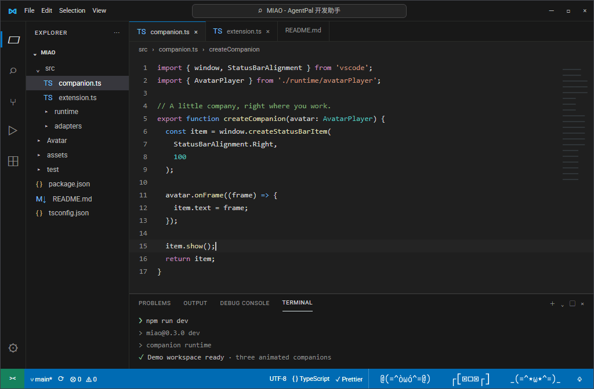

# MIAO - AgentPal

**Your coding agents, at a glance.**

**English** | [简体中文 ↓](#中文说明)

MIAO - AgentPal is a lightweight coding companion in the VS Code status bar. It supports **Claude Code, KiloCode, Codex and OpenCode**, observing their local sessions and using built-in animated kaomoji avatars to show whether a project is working, waiting for input, or finished.

## Features

- **One project, one avatar**: sessions in the same project share an aggregated display while retaining independent session states.
- **Five states**: idle, working, waiting, success and error.
- **Built-in avatars and colors**: choose a built-in avatar, project color and name. Saved appearance and order survive session completion.
- **Session details**: click the status bar avatar to view sources, directories, titles and states, and give sessions a custom name.
- **Sound alerts**: independently enable or disable sounds for waiting, completion and errors that require human action.
- **Display scope**: show only the current workspace or all known projects.
- **Localized interface**: English, Simplified Chinese and Traditional Chinese.

## Install

[Install MIAO - AgentPal from the VS Code Marketplace](https://marketplace.visualstudio.com/items?itemName=fatq.miao-vscode-extension), or search for **MIAO - AgentPal** in the Extensions view.

## Privacy

MIAO - AgentPal reads agent state locally. It has no cloud service of its own and does not upload conversations to MIAO.

## Current limitations

- The Marketplace listing is currently a pre-release; some integrations may miss states depending on the agent version.
- SessionEnd is not connected yet.
- Built-in connectors and built-in avatars only.

---

## 中文说明

[Back to English ↑](#miao---agentpal)

### MIAO - AgentPal

**让编程 Agent 的状态一眼可见。**

MIAO - AgentPal 用经典颜文字表情动画展示 **Claude Code、KiloCode、Codex 和 OpenCode** 的工作状态，并显示在 VS Code 状态栏。不用一直盯着终端，看一眼状态栏就知道 Agent 是在工作、等待你确认，还是已经完成。

### 功能

- **一个项目一个形象**：同一项目的多个会话合并显示，各会话状态仍然独立。
- **五种状态**：空闲、工作中、等待操作、完成、错误。
- **内置形象和颜色**：为项目选择形象、颜色和名称，设置会保存。
- **查看会话**：点击状态栏形象打开面板，查看会话来源、目录、标题和状态，也可以给会话重命名。
- **声音提醒**：等待操作、任务完成和错误提示音可以分别开关。
- **显示范围**：只显示当前工作区，或显示所有已知项目。
- **界面语言**：简体中文、繁体中文和英文。

### 安装

[从 VS Code 插件市场安装 MIAO - AgentPal](https://marketplace.visualstudio.com/items?itemName=fatq.miao-vscode-extension)，也可以在扩展视图搜索 **MIAO - AgentPal**。

### 隐私

MIAO - AgentPal 在本机读取 Agent 状态，没有自己的云端服务，也不会将对话上传到 MIAO。

### 当前限制

- 插件市场当前为 pre-release；部分来源的状态覆盖可能因 Agent 版本不同而有差异。
- SessionEnd 尚未接入。
- 仅提供内置连接器和内置形象。

---

MIAO - AgentPal is released under the [MIT License](LICENSE).
